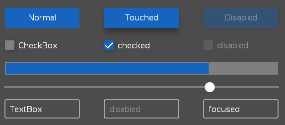

# Medja

Historical C# UI framework for embedded-style applications, separating control
behavior from rendering to support headless interaction testing and
SkiaSharp/OpenGL integration through OpenTK.

Developed primarily in 2018-2021 with support from **SprintWORX GmbH**, which
authorized publication of the Medja source. Daniel Bişar (credited as Daniel
Klafft in earlier history) designed and implemented substantial parts of the
framework, alongside the contributors acknowledged below.



*Historical demo: control state, layout and behavior are independent of the
theme-specific rendering shown here.*

**Status:** preserved for architectural and educational value, with targeted
correctness and reproducibility maintenance rather than an active product
roadmap. The CPU-only tests run on modern .NET; the graphics backend remains a
legacy .NET Framework/Mono stack. See [build and verification](docs/build.md).

## Engineering highlights

- **Testable UI behavior:** layout, focus, selection and keyboard/mouse input can
  be exercised without a window or graphics context.
- **Property and binding infrastructure:** typed properties, change notification,
  one-/two-way binding, attached properties and change tracking.
- **Rendering separation:** control factories and renderer abstractions connect
  the control model to themes without putting graphics calls in control logic.
- **Graphics/native integration:** SkiaSharp drawing, OpenTK input/window
  integration, OpenGL components, context management and resource lifecycles.
- **Performance/debugging experiments:** graph downsampling, rendering
  invalidation, dispatcher queues and native rendering prototypes. Historical
  measurements are workload-specific notes, not a claim of superiority to WPF.

Start with the [headless text-editor tests](src/Medja.Test/Controls/TextEditor/TextEditorTest.cs),
[binding tests](src/Medja.Properties.Test/Binding/BindingTest.cs), or
[demo application](src/examples/demo/Program.cs).

## Architecture

```text
Controls / layout / input       Medja
          |
Property / binding layer       Medja.Properties
          |
Renderer abstraction / themes  Medja.Theming + Medja.OpenTk.Themes
          |
OpenTK window/input + SkiaSharp drawing + OpenGL components
```

The diagram shows responsibilities, not a strict runtime call sequence.
Controls use properties to signal state changes; factories attach renderers.
Tests can use a plain control factory without the native graphics layer.

| Module | Responsibility |
| --- | --- |
| `Medja` | Controls, layout, input state, primitives and rendering contracts |
| `Medja.Properties` | Properties, bindings and change tracking |
| `Medja.Utils` | Collections, IO, threading and supporting utilities |
| `Medja.OpenTk` | Window/input adaptation and SkiaSharp/OpenGL integration |
| `Medja.OpenTk.Themes` | Theme-specific renderers |
| `Medja.ProtoBuf`, `Medja.ZeroMQ` | Optional serialization/messaging integrations |

## Current status

Main implementation history spans 2018-2021, with publication/build adjustments
in 2022 and focused maintenance in 2026. This is not a newly launched or
production-supported UI toolkit.

| Scope | Current verification |
| --- | --- |
| Headless behavioral tests | Executed on Linux x86-64 with .NET SDK 10.0.112; CI runs the same CPU-only suites |
| Core libraries | Preserve their `netstandard2.0` targets |
| Graphics backend, themes and maintained examples | Compile against `net472`; this does not verify graphics runtime behavior |
| GUI runtime | Historically developed mainly on Linux/Mono; current rendering, touch devices, Windows and macOS are not revalidated |
| Native Linux graphics | Committed SkiaSharp binary is x86-64 only; no current ARM/ARM64 support claim |

## Quick start

Install **.NET SDK 10.0.112**, matching [global.json](global.json), then run from
the repository root:

```bash
bash build/test_headless.sh
```

This restores, builds and executes the control, utility, property, protobuf and
ZeroMQ-prefix tests without Mono, a display or a GPU. ZeroMQ-prefix tests do not
open native sockets. [GitHub Actions](.github/workflows/headless.yml) verifies
this supported headless scope.

To compile the main visual demo:

```bash
dotnet restore src/examples/demo/demo.csproj
dotnet build src/examples/demo/demo.csproj --configuration Release --no-restore
```

Running that `net472` executable additionally requires a compatible .NET
Framework/Mono runtime and graphics/native libraries. Those runtime combinations
are not covered by the headless CI; see [build instructions](docs/build.md) and
the [example index](src/examples/README.md).

## Limitations

- No current cross-platform/device support matrix or comparative WPF benchmark.
- Graphics dependencies are intentionally historical. The committed native
  SkiaSharp 1.68.0 binary and managed 1.68.2.1 pairing needs runtime validation.
- Markup/designer tooling, validation and some controls remain incomplete.
- Production Graph2D rendering is incomplete; the graph example uses its own
  small synthetic-data renderer.
- The generic `MedjaSerializer` scaffold is explicitly unsupported; this does
  not affect the separate tested protobuf reader/writer.
- Some [prototypes](src/prototypes/README.md) retain obsolete APIs or incomplete
  code. Their status is documented rather than presented as supported features.

## Historical documentation

[Documentation index](docs/README.md) includes architecture notes, experiment
records, control-authoring guidance, [testing](docs/testing.md), and
[archival asset context](docs/assets.md). Old design goals and marketing material
are retained as history, not a current roadmap or verified support claim.

## Attribution and licensing

Thank you to **SprintWORX GmbH** for supporting the work and allowing publication.
Historical company copyright remains in the [MIT license](LICENSE.md).

Contributors and supporters include Daniel Bişar / Daniel Klafft,
**Matthias Fritsch** (SprintWORX GmbH), and **Jan Schmitt / @lockejan**
(control development). Git history records individual contributions; this
repository does not imply sole authorship of every component.

The README historically referenced
[lockejan's secure-text-editor](https://github.com/lockejan/secure-text-editor)
as a user of Medja; current compatibility is not asserted.

Dependencies and embedded fonts retain their own licenses, including LGPL
components. See [third-party notices and native provenance](THIRD-PARTY-NOTICES.md);
the entire dependency stack is not MIT.
